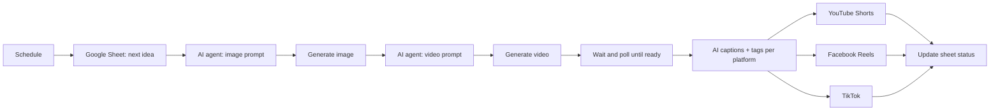

# n8n Content Automations

**Ready-to-import n8n workflows that generate, caption and publish AI videos automatically on YouTube, Facebook and TikTok.**

Each workflow runs on a schedule, reads its queue from Google Sheets, calls AI models for prompts, images, video and voice, and updates the sheet at every step so you always know where each video is.

## Workflows

| Workflow | What it does | Stack |
|---|---|---|
| [`ai-shorts-multiplatform.json`](workflows/ai-shorts-multiplatform.json) | Turns an idea from a Google Sheet into an AI-generated short (image, then video), writes platform-specific captions and tags, and publishes to **YouTube Shorts, Facebook Reels and TikTok**. Runs every 7 hours. | AI agents (OpenRouter), Kie.ai (image + Veo video), YouTube API, Facebook Graph API, Google Sheets |
| [`youtube-long-video-generator.json`](workflows/youtube-long-video-generator.json) | Generates a reference image, writes **20 scene prompts**, renders each clip with Kling, then writes the YouTube title, description and tags. Runs daily. | OpenRouter, Kie.ai, PiAPI (Kling), Google Sheets |
| [`youtube-compilation-ffmpeg.json`](workflows/youtube-compilation-ffmpeg.json) | Picks unused clips, writes a script, generates an **AI voice-over**, builds the **FFmpeg** command, renders the final compilation, uploads it to YouTube and marks the clips as used. Runs weekly. | OpenRouter, ElevenLabs, FFmpeg, Google Drive, YouTube API |
| [`tiktok-drive-to-cloudinary.json`](workflows/tiktok-drive-to-cloudinary.json) | Watches a Google Drive folder, uploads new videos to Cloudinary, writes a TikTok caption with AI, archives the file and logs everything in a sheet. Runs every 10 minutes. | Google Drive, Cloudinary, OpenRouter, Google Sheets |

## How the main pipeline works

Design choices that make it reliable in production:

- **Status tracking in Google Sheets**: every step writes its status, so a failed run can be resumed without regenerating paid assets.
- **Polling with waits** for long AI jobs (image and video generation) instead of fixed delays.
- **Switch nodes** route each job by status (pending, image ready, video ready, published).
- **Separate captions per platform**: YouTube, Facebook and TikTok each get their own title, description and hashtags.

## Setup

1. In n8n, go to **Workflows → Import from file** and select a JSON file.
2. Create the credentials it needs (Google Sheets, YouTube, Google Drive, Cloudinary, OpenRouter or HTTP header auth).
3. Replace the placeholders:
   - `YOUR_DOCUMENTID`, `YOUR_PLAYLISTID`, `YOUR_FOLDERID`: your own sheet, playlist and folder IDs
   - `YOUR_OPENROUTER_API_KEY`, `YOUR_KIE_AI_API_KEY`, `YOUR_PIAPI_KEY`, `YOUR_ELEVENLABS_API_KEY`: your API keys (better stored as n8n credentials)
4. Run once manually, check the sheet, then activate the schedule.

No credentials, IDs or personal data are included in this repository.

## Services

I build custom n8n and Python automations: content pipelines, AI agents, scraping, Telegram bots and integrations between your tools. Contact me on Upwork.
